# ytcui v5 (=^･ω･^=)

A terminal YouTube client — search, play, and manage videos without leaving your shell.

Built in **C++17 with ncurses**, with playback through **mpv**. Choose between the native **ytcui-dl** extractor, the separate **ytcui-we** companion, and **yt-dlp** at runtime.

[](https://github.com/MilkmanAbi/ytcui-test-repo/actions/workflows/ci.yml)
[](LICENSE)

<p align="center">
  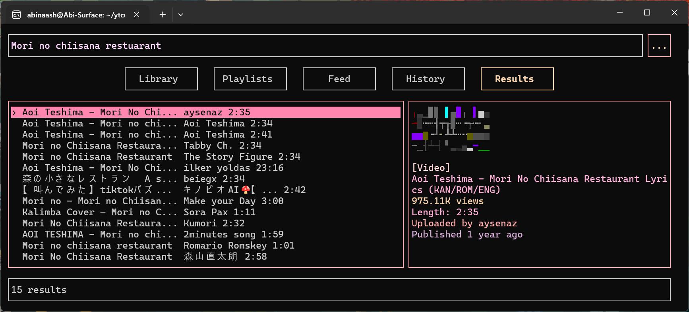
  <br>
  <em>00 · The full interface: search results alongside video details. Captured in Windows Terminal under WSL.</em>
</p>

This repository is the **v5 development and test repository** for [MilkmanAbi/ytcui](https://github.com/MilkmanAbi/ytcui). The version is recorded in [VERSION](VERSION). This README follows the upstream guide, updated for the code and build system here.

## Screenshot gallery

Expand a section below. All 14 screenshots are stored in [Pictures/](Pictures), numbered by feature rather than capture time. The main image above is **00**.

<details>
<summary><strong>Search · sorting and filters</strong></summary>

<p align="center">
  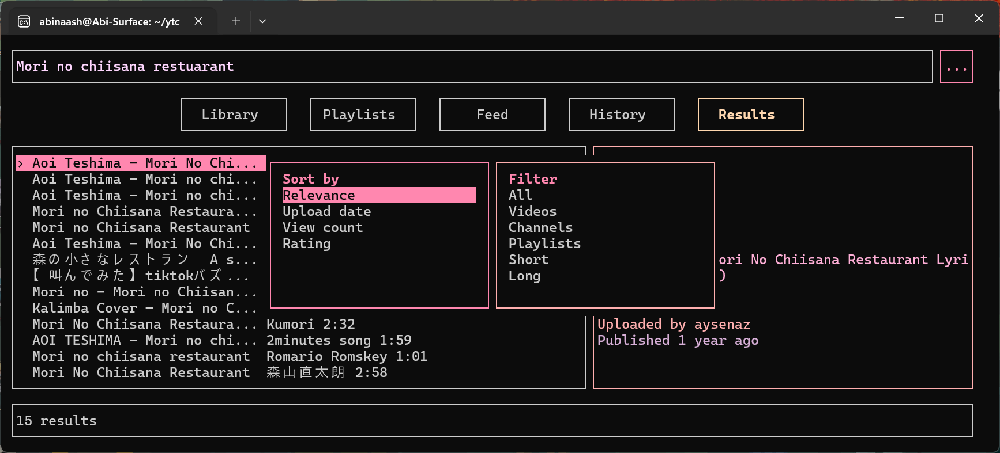
  <br>
  <em>01 · Sort by relevance, upload date, view count or rating, and filter the type or length of results.</em>
</p>

</details>

<details>
<summary><strong>Your collection · library, playlists, feed and history</strong></summary>

<p align="center">
  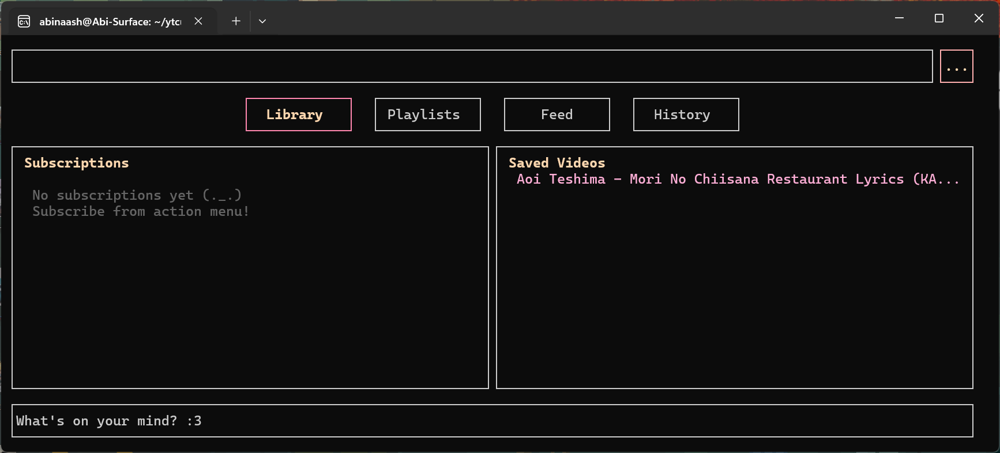
  <br>
  <em>02 · Library keeps channel subscriptions and saved videos together.</em>
</p>

<p align="center">
  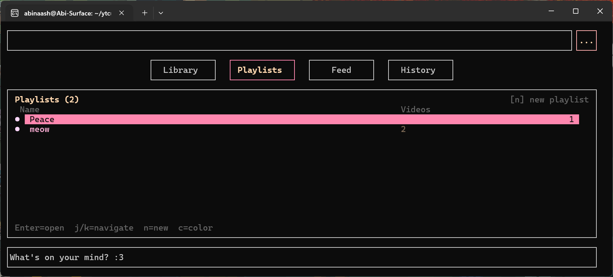
  <br>
  <em>03 · Create and browse local playlists, see video counts, and assign playlist colours.</em>
</p>

<p align="center">
  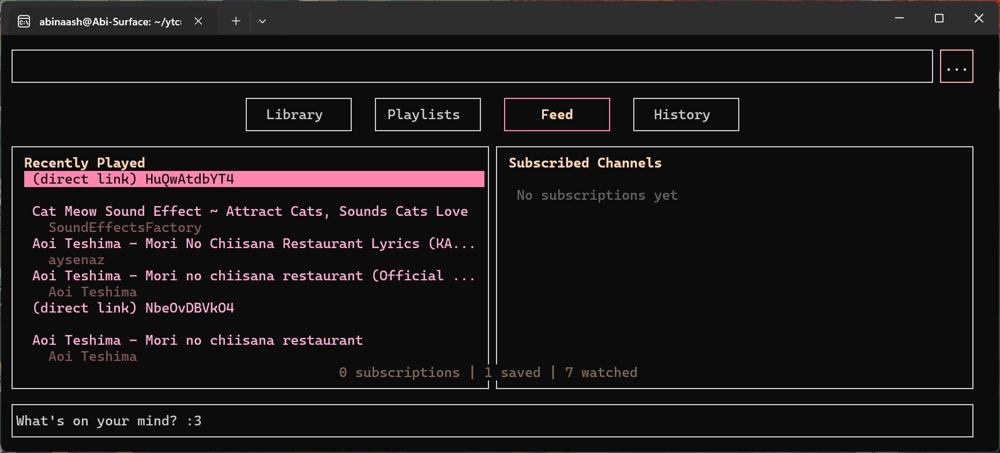
  <br>
  <em>04 · Feed puts recently played videos beside your subscribed channels.</em>
</p>

<p align="center">
  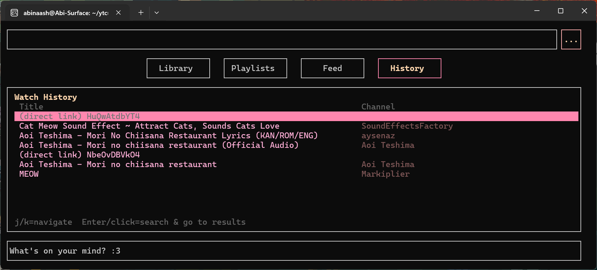
  <br>
  <em>05 · Revisit watch history; selecting an entry searches for it and returns to results.</em>
</p>

</details>

<details>
<summary><strong>Make it yours · themes, keybindings and general settings</strong></summary>

<p align="center">
  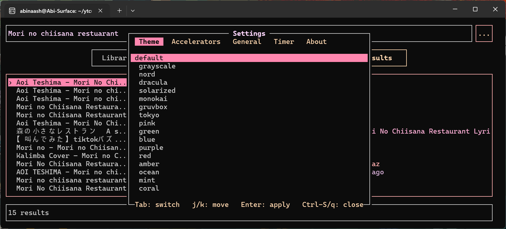
  <br>
  <em>06 · Change themes live from Settings, without restarting.</em>
</p>

<p align="center">
  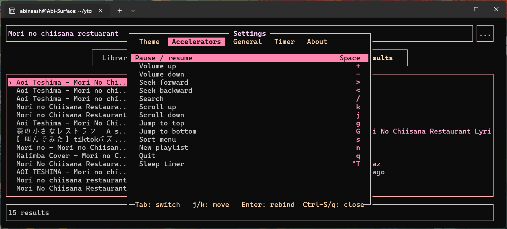
  <br>
  <em>07 · Rebind playback and navigation keys in the Accelerators tab.</em>
</p>

<p align="center">
  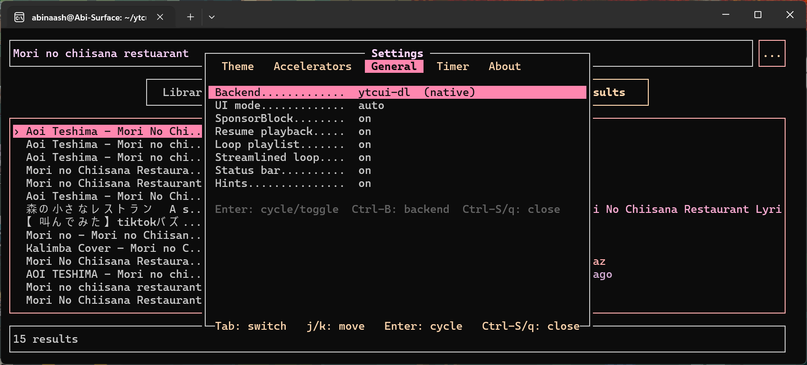
  <br>
  <em>08 · Choose a backend or interface mode and configure SponsorBlock, resume, looping and interface hints.</em>
</p>

</details>

<details>
<summary><strong>Playback tools · sleep timer and QR sharing</strong></summary>

<p align="center">
  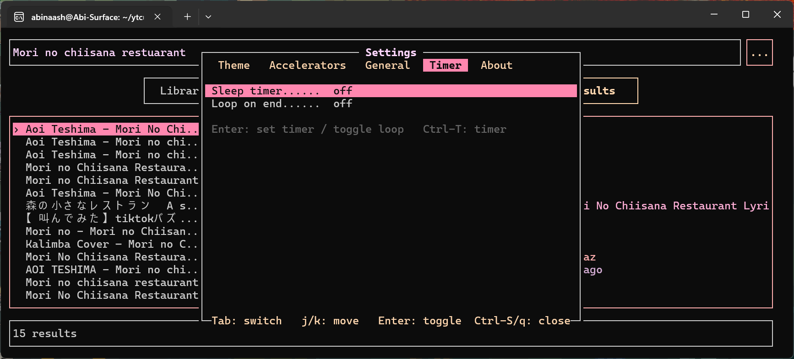
  <br>
  <em>09 · Manage the sleep timer and loop-on-end option from Settings.</em>
</p>

<p align="center">
  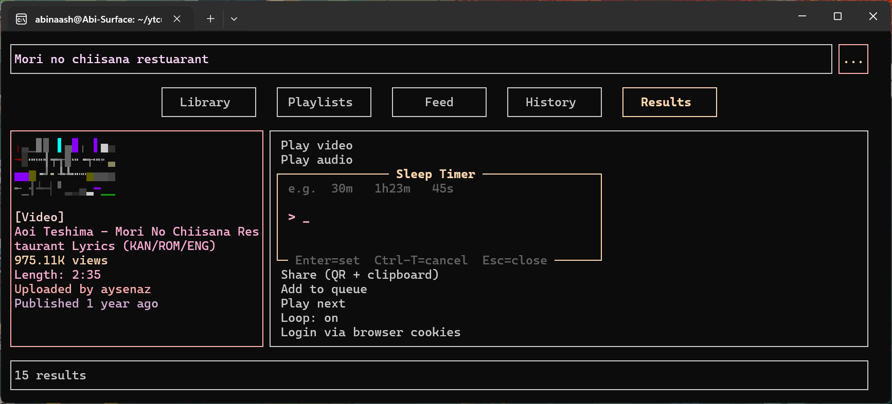
  <br>
  <em>10 · Set a sleep timer using a duration such as 30m, 1h23m or 45s.</em>
</p>

<p align="center">
  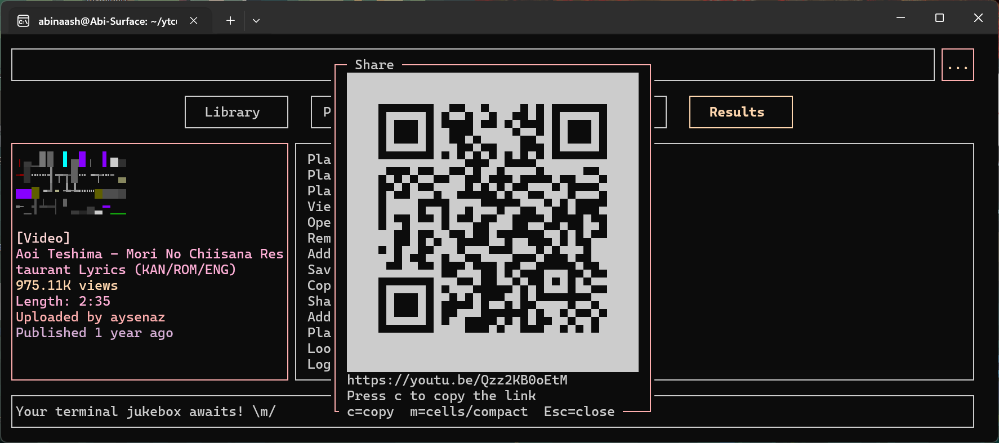
  <br>
  <em>11 · Scan the QR code or press c to copy the URL; m switches between cell and compact rendering.</em>
</p>

</details>

<details>
<summary><strong>Small terminals · streamlined mode</strong></summary>

<p align="center">
  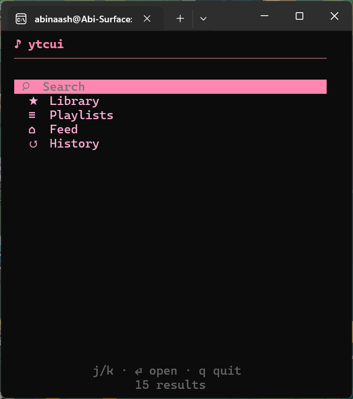
  <br>
  <em>12 · The streamlined section menu keeps navigation available in a narrow terminal.</em>
</p>

<p align="center">
  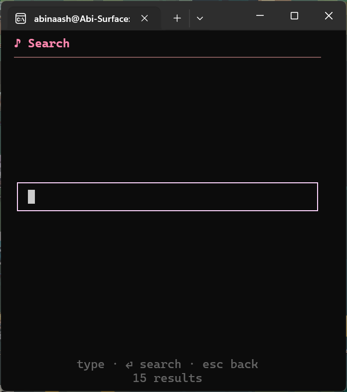
  <br>
  <em>13 · Compact search: type a query, press Enter, or Escape to return.</em>
</p>

</details>

## What's in v5

- **Three runtime backends:** cycle through ytcui-dl → ytcui-we → yt-dlp with `Ctrl-B`, or choose one in Settings → General. No rebuild required.
- **Resolution selection:** press `r` to request the quality selector. Choices depend on the backend and resolved video; your preferred height is saved.
- **Queue and playback controls:** queue videos, play an item next, pause, seek, adjust volume, and resume saved playback positions.
- **SponsorBlock:** optional skipping of configured segment categories, switchable in Settings.
- **Sleep timer and looping:** enter durations from `Ctrl-T` and control looping from the action menu or Settings.
- **QR and clipboard sharing:** a nonblocking dialog with full-cell and compact rendering, and terminal-size checks.
- **Full and streamlined layouts:** automatic switching for narrow windows, or an explicit mode choice.
- **Terminal portability:** bounded text rendering, UTF-8 input, low-colour fallbacks and modal handling across both layouts.

YouTube changes can break extraction. Keep the external yt-dlp fallback current and try another backend when a video fails. Available videos and resolutions depend on extraction and session support.

## Install and build

### Build this repository directly

Use a C++17 compiler, CMake 3.16 or newer, and development libraries for **wide-character ncurses, OpenSSL, zlib and libcurl**. **mpv** is required for playback.

On Debian/Ubuntu or WSL Ubuntu:

```bash
sudo apt-get update
sudo apt-get install build-essential cmake ninja-build pkg-config \
  libncursesw5-dev libssl-dev zlib1g-dev libcurl4-openssl-dev mpv

git clone https://github.com/MilkmanAbi/ytcui-test-repo.git
cd ytcui-test-repo
cmake -S . -B build -G Ninja -DCMAKE_BUILD_TYPE=Release
cmake --build build --parallel 2
./build/ytcui
```

The build produces both `ytcui` and its `ytcui-we` companion, plus player-script assets under `build/vendor/ejs/`. Run from the build directory layout or install the complete bundle:

```bash
cmake --install build --prefix "$HOME/.local"
```

Ensure `$HOME/.local/bin` is on your `PATH`.

On macOS, install Xcode Command Line Tools and dependencies through Homebrew or MacPorts. The Makefile wrapper supplies Homebrew dependency hints:

```bash
brew install cmake ninja pkg-config ncurses openssl zlib curl mpv
make
./build/ytcui
```

| Platform | Build approach |
|---|---|
| Linux / WSL | CMake with GCC or Clang; distribution development packages |
| macOS | CMake / Makefile wrapper; Homebrew or MacPorts dependencies |
| FreeBSD / NetBSD / OpenBSD | CMake with system compiler and ports/pkg dependencies; covered by CI jobs |
| Windows | Run the terminal client through WSL |

C++17 is the language baseline. Compatibility with an older OS also depends on its compiler, libraries and available mpv version.

### Optional tools

| Tool | Used for |
|---|---|
| `yt-dlp` | External fallback extraction backend |
| JavaScript runtime | ytcui-we player-script handling; check with `./build/ytcui-we --check-runtime` |
| `chafa` | Terminal thumbnail rendering |
| `ffmpeg` | Download conversion and muxing |
| `wl-copy` / `xclip` / `xsel` | Linux clipboard integration; macOS uses `pbcopy` |

### Interactive installer

The upstream OIS-based installer is also included:

```bash
sh install.sh
```

It offers dependency, theme and playback setup. For testing this exact repository revision, use the direct CMake build above. Upstream update and installation-management commands may follow the main ytcui project rather than this test repository.

## Usage

```bash
ytcui                         # launch
ytcui -t pink                 # select a theme
ytcui -t dracula
ytcui --mode normal           # full interface
ytcui --mode streamlined      # compact interface
ytcui --mode auto             # automatic layout selection
ytcui --gfx sixel             # explicitly select a thumbnail renderer
ytcui --colors                # colour element reference
ytcui --diag                  # dependency and terminal diagnostics
ytcui --debug --logdump        # detailed diagnostic logging
ytcui --no-update-check        # disable the upstream startup update check
ytcui --help
ytcui --version
```

## Keys

Playback keys apply outside text-entry fields and dialogs that own input. Open `?` for help; use `Ctrl-S` → Accelerators to rebind supported actions.

| Key | Action |
|---|---|
| `j` / `k`, arrow keys | Move through lists |
| `h` / `l` | Move across tabs or menus |
| `Tab` | Cycle panel focus |
| `Enter` | Select / open an action menu |
| `Esc` | Back / cancel |
| `/` | Focus search |
| `Space` / `p` | Pause / resume |
| `+` / `-` | Adjust volume |
| `<` / `>` | Seek backward / forward |
| `s` | Sort and filter |
| `g` / `G` | First / last result |
| `n` | New playlist in the Playlists tab |
| `r` | Request resolution selection |
| `Ctrl-B` | Cycle extraction backend |
| `Ctrl-Q` | Open / close the queue |
| `Ctrl-T` | Sleep timer |
| `Ctrl-S` | Settings |
| `?` | Shortcut reference |
| `q` | Quit, or close the active dialog where applicable |

Mouse support includes tabs, result rows, action items and scrolling. Some terminals intercept control keys; use the corresponding settings or action menu when necessary.

## Tabs and streamlined mode

| Tab | Contents |
|---|---|
| Library | Channel subscriptions and saved videos |
| Playlists | Local playlists and their videos |
| Feed | Recently played videos and subscribed channels |
| History | Previously played items |
| Results | Current search and selected-video details |

Streamlined mode presents Search, Library, Playlists, Feed and History as a compact section menu, with a separate now-playing view. Use `j` / `k` and `Enter` to navigate, and `Esc` to go back. Settings and playback dialogs are available in both layouts.

## Backends

| Backend | Role |
|---|---|
| **ytcui-dl** | Built-in native C++ YouTube extraction; the default backend |
| **ytcui-we** | Separate C++ resolver executable with player-script and session support; invoked as a companion process |
| **yt-dlp** | External extractor; install separately to use this fallback |

The ytcui-we backend resolves streams through its own executable. Selecting it does not move playback into a browser: **mpv plays the resolved media**. Browser-cookie login supplies session data for extraction rather than embedding a browser player.

Browser login is available from the video action menu. Keep session and cookie files private. For companion lookup or runtime problems, verify that `ytcui-we` is installed alongside `ytcui` and run its `--check-runtime` command.

## Themes and configuration

Use `ytcui -t <name>` or Settings → Theme. Theme and key changes persist across launches. Themes include `default`, `grayscale`, `nord`, `dracula`, `solarized`, `monokai`, `gruvbox`, `tokyo`, `pink`, `green`, `blue`, `purple`, `red`, `amber`, `ocean`, `mint`, `coral` and `slate`.

Configuration normally lives at `~/.config/ytcui/config.json`. For example:

```json
{
  "theme": "pink",
  "max_results": 15,
  "show_thumbnails": true,
  "no_hardware_accel": false,
  "backend": 0,
  "backend_auto_failover": true,
  "preferred_height": 0,
  "resume_playback": true,
  "sponsorblock": true,
  "keys": {
    "search": "/",
    "pause": " ",
    "volume_up": "+",
    "volume_down": "-",
    "seek_fwd": ">",
    "seek_back": "<",
    "quit": "q"
  },
  "colors": {}
}
```

Backend values are `0` for ytcui-dl, `1` for yt-dlp, and `2` for ytcui-we. `preferred_height: 0` requests the best available resolution; a saved height is a preference subject to stream availability.

Custom colour overrides go in `colors`, for example `"accent": 198`, `"title": 213`, `"border": 141`. Run `ytcui --colors` for the full reference.

| Location | Contents |
|---|---|
| `~/.config/ytcui/` | Configuration |
| `~/.local/share/ytcui/` | Library, playlists, watch history and playback state |
| `~/.cache/ytcui/` | Cached data and diagnostics |

The application supports XDG configuration, data and cache directory overrides.

## Tests and CI

```bash
cmake -S . -B build -DCMAKE_BUILD_TYPE=Debug
cmake --build build --parallel 2
ctest --test-dir build --output-on-failure
```

[CI](https://github.com/MilkmanAbi/ytcui-test-repo/actions/workflows/ci.yml) includes Linux GCC and Clang builds, macOS and BSD jobs, executable smoke checks, regression tests and a sanitizer job. Tests cover terminal rendering and input, queue/timer behaviour, configuration, process handling, backend integration and installed-bundle checks. Native terminal appearance also benefits from testing on the actual terminal and OS.

[Release automation](https://github.com/MilkmanAbi/ytcui-test-repo/actions/workflows/release.yml) runs CI before packaging supported Linux and macOS binaries. See [Releases](https://github.com/MilkmanAbi/ytcui-test-repo/releases) for published assets.

## Troubleshooting

**QR code does not fit:** enlarge the terminal or press `m` in the share dialog to try compact rendering. The dialog avoids drawing a clipped code. Press `c` to copy the URL instead. On Terminal.app, full-cell rendering is the default; compact blocks depend on font and character-width settings.

**Text looks garbled:** use an installed UTF-8 locale and a terminal font with the needed glyphs. Run `ytcui --diag` to inspect detected capabilities.

**No thumbnails:** install `chafa` and check `ytcui --diag`. Raster graphics require terminal support; try a compatible `--gfx` mode or disable thumbnails.

**Playback or extraction fails:** confirm mpv is installed, try `Ctrl-B` to change backend, and check the ytcui-we companion/runtime or external yt-dlp installation. Authentication and video availability can also affect extraction.

**Clipboard copy fails:** check the reported status and install a clipboard helper appropriate to your desktop. Terminal clipboard escape support varies, especially through multiplexers.

**Need a diagnostic log:** run `ytcui --debug --logdump`. Review logs for private session information before sharing them.

## Credits and related projects

- [ytcui](https://github.com/MilkmanAbi/ytcui) — upstream terminal client and original README.
- [ytcui-dl](https://github.com/MilkmanAbi/ytcui-dl) — native extraction library.
- [ytcui-we](https://github.com/MilkmanAbi/ytcui-we) — companion extraction project.
- [yt-dlp](https://github.com/yt-dlp/yt-dlp) — external fallback backend and a major reference for YouTube extraction work.
- [mpv](https://mpv.io/) — media playback and JSON IPC controls.
- [Nayuki QR Code generator](https://www.nayuki.io/page/qr-code-generator-library) — bundled QR encoding library.
- [OIS](https://github.com/MilkmanAbi/oneinstallsystem) — installation tooling.
- [ytcui-termux](https://github.com/MilkmanAbi/ytcui-termux) and [ytcui-dotmatrix](https://github.com/MilkmanAbi/ytcui-dotmatrix) — related clients.

## License

[MIT](LICENSE). Bundled third-party components retain their own license notices.

*Made with (=^･ω･^=) and ncurses.*
